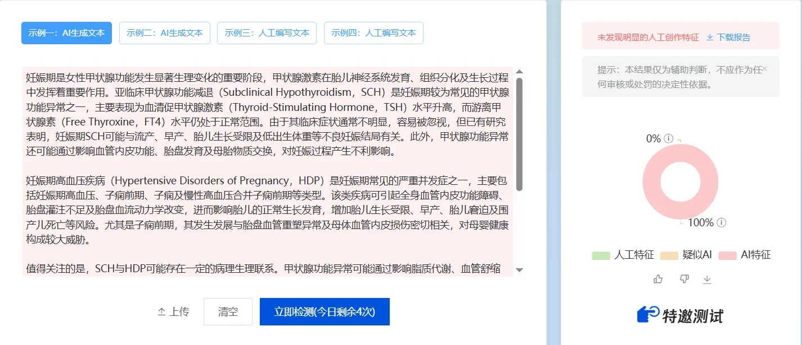
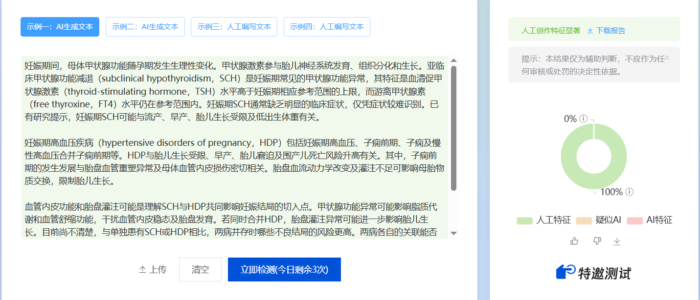
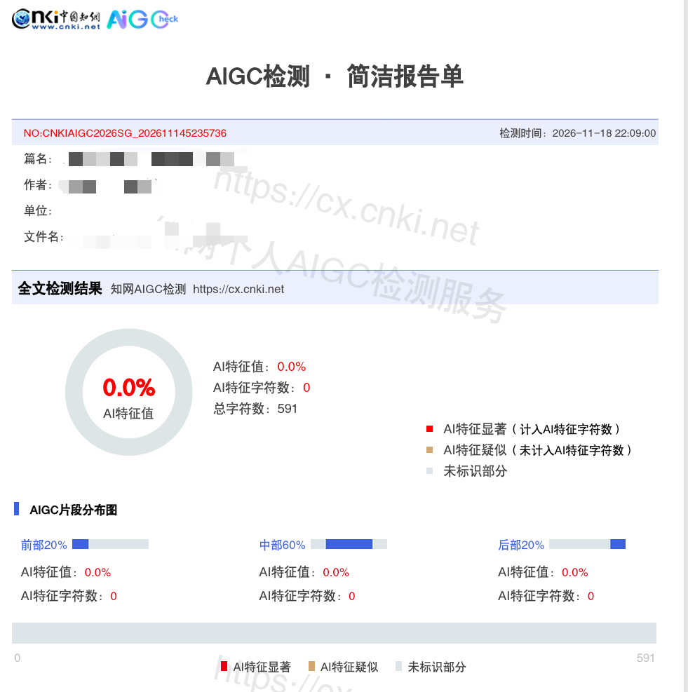

# Anti-AI-Writing

Anti-AI-Writing 是一个中文写作润色 Skill，主要用于修改已经写好的论文段落，也适用于研究报告、项目说明和一般文章。把原文交给 Codex，它会删去重复铺垫，理顺句间关系，保留作者的术语、数据、引文和判断。默认输出可直接放回原文的修改稿。

## Codex 桌面版：用一句指令安装

打开 Codex 桌面版，新建对话，把下面整句话复制到输入框并发送。

```text
请帮我从 GitHub 仓库 https://github.com/AphroditeYu/Anti-AI-Writing 安装这个 Skill。
```

## 它具体会改什么

| 原稿常见问题 | Skill 的处理方式 |
| --- | --- |
| 符号使用过多 | 去掉只为强调而加的引号，用完整句子承接过长的插入语。直接引语、公式和区间符号按原样保留。 |
| 习惯用无序列表 | 把有先后或因果关系的内容连成段落。独立条件和需要逐项执行的步骤仍可用列表。 |
| 喜欢用对比句式 | 直接写出作者的判断。涉及对照组或竞争解释时，保留比较对象和实际差别。 |
|抽象词汇堆砌 | 从原稿中找回具体动作。例如，作者已交代按学号核对两份表，就写出核对过程。 |
| 结尾强行升华 | 收在材料能支持的发现、限制或用途上，删去与本段无关的宏观评价。 |
| 开头套用模板 | 提前交代研究对象、问题或观察结果，把解释它所需的背景放到相应位置。 |
| 编造信息论证 | 核对改稿中的数字与引文。原文依据不清时，给作者留下待核提示，不补造文献或数据。 |
| 句首连接词太多 | 用上句提到的对象承接下句，保留表达转折、条件或让步所必需的词。 |

例如，结果段中的“可能与早产有关”在润色后仍应保留“可能”和关联的含义。作者可以要求精简句子，也可以让 Codex 解释影响科学含义的改动。

## 论文润色前后对照

### 同一篇医学引言在朱雀上的两次检测

这篇引言讨论妊娠期亚临床甲状腺功能减退与妊娠期高血压疾病。两张截图来自同一段引言的原稿和改稿。以开头为例：

| 调用前 | 调用后 |
| --- | --- |
| 妊娠期是女性甲状腺功能发生显著生理变化的重要阶段，甲状腺激素在胎儿神经系统发育、组织分化及生长过程中发挥着重要作用。 | 妊娠期间，母体甲状腺功能随孕期发生生理变化。甲状腺激素参与胎儿神经系统发育、组织分化和生长。 |

原稿用两次“重要”把两个判断连在一起。改稿将母体的生理变化和激素在胎儿发育中的作用分成两句，读者可以分别读清每句的主语。

**调用前 · 朱雀显示 AI 特征占比 100%。**



**调用后 · 朱雀显示 AI 特征占比 0%，人工特征占比 100%。**



### 另一份润色稿的知网报告

知网检测的是《课程论文修改意见的采纳如何计数》的润色稿。简洁报告记录的全文 **AI 特征值为 0.0%**，总字符数为 **591**，AI 特征字符数为 **0**。这份样稿仅送检了润色后的版本。



这些数值对应图中两份具体样稿。其他稿件的检测结果需要对相应文本单独测量。

## 在 Codex CLI 中使用

需要本机已安装 Git 和 Codex CLI，并已登录 Codex。克隆私有仓库还需要相应的 GitHub 读取权限。桌面版和 CLI 如果在同一系统用户下使用，个人目录中的 Skill 安装一次即可。如果 CLI 运行在 WSL 或远程机器上，请在那个环境中安装。

**首次安装。** 在准备存放仓库的目录中执行对应命令。已有本地克隆时，跳过 `git clone`，从克隆所在的父目录执行复制命令。

Windows PowerShell

```powershell
git clone https://github.com/AphroditeYu/Anti-AI-Writing.git
$skillDir = Join-Path $env:USERPROFILE '.agents/skills/anti-ai-writing'
New-Item -ItemType Directory -Force -Path $skillDir | Out-Null
Copy-Item -LiteralPath './Anti-AI-Writing/skills/anti-ai-writing/SKILL.md' -Destination $skillDir
Test-Path -LiteralPath (Join-Path $skillDir 'SKILL.md')
```

macOS、Linux 或 WSL

```bash
git clone https://github.com/AphroditeYu/Anti-AI-Writing.git
mkdir -p "$HOME/.agents/skills/anti-ai-writing"
cp ./Anti-AI-Writing/skills/anti-ai-writing/SKILL.md "$HOME/.agents/skills/anti-ai-writing/"
ls "$HOME/.agents/skills/anti-ai-writing/SKILL.md"
```

**交互式润色。** 进入论文所在目录，运行 `codex`。在 Codex 会话中输入 `/skills` 查看可用技能，再输入以下请求。将其中的文件名和小节换成自己的，也可以直接粘贴原文。

```text
用 $anti-ai-writing 润色 discussion.md 中“研究局限”的第一段。
保留样本范围、引文和作者语气。在对话里给我修改稿，保留我的的原稿。
```

**将结果保存为单独文件。** 如果当前目录下已有 `discussion.md`，以下命令可以在普通论文文件夹中直接运行。先选一个尚未使用的输出文件名。命令里的单引号会把 `$anti-ai-writing` 原样传给 Codex。

```bash
codex exec --skip-git-repo-check --sandbox read-only -o discussion-edited.md '用 $anti-ai-writing 润色当前目录的 discussion.md。保留小标题、引文、数字和限定条件。最终答复只给完整修改稿。'
```

